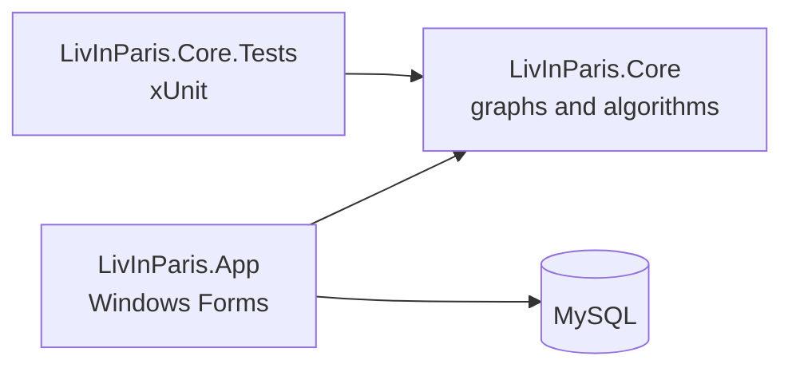

# Liv'In Paris

[](https://github.com/srn8r/ProjetLivInParis/actions/workflows/ci.yml)


A desktop app for a home-cooked meal delivery platform in Paris. Neighbourhood cooks publish
dishes, customers order them, and each delivery is routed through the **Paris metro network
modelled as a weighted graph**.

Built in C# (.NET 8, Windows Forms) with a MySQL database, as an engineering school project at ESILV.

## Features

- **Accounts and roles**: sign-up and login with customer, cook and admin areas (a user can be both customer and cook)
- **Customers**: browse available dishes, order, follow their orders and see the delivery route
- **Cooks**: publish dishes (quantity, production and expiry dates, price, diet), manage incoming orders
- **Admin**: manage users and orders, statistics, metro map, order-graph colouring, XML export
- **Routing**: shortest path in minutes between the cook's and the customer's metro stations, line changes included
- **Security**: passwords hashed with PBKDF2-SHA256 (accounts created with the old plain-text format are upgraded at their next login)

## Architecture



The domain logic lives in **`LivInParis.Core`**, a plain .NET 8 library with no UI or database
dependency. It builds and is tested on any OS. The Windows Forms app handles screens and SQL.

| Component | Role |
|---|---|
| `Graphe<T>`, `Noeud<T>`, `Lien<T>` | Generic weighted directed graph |
| `ReseauMetro` | Builds the metro graph (line links + interchanges), nearest station, Haversine distance |
| `GrapheCommandes` | Customer / cook graph and Welsh-Powell colouring |
| `PasswordHasher` | PBKDF2 password hashing and verification |

### Graph algorithms

| Algorithm | Complexity | Use |
|---|---|---|
| Dijkstra (binary heap) | O((V + E) log V) | Delivery route between two stations |
| Bellman-Ford | O(V · E) | Selectable on the admin metro map, detects negative cycles |
| Floyd-Warshall | O(V³) | Selectable on the admin metro map (all-pairs distances) |
| Welsh-Powell | O(V²) | Colouring of the order graph. Two colours means customers and cooks form a bipartite graph |

The metro graph has one node per (station, line). Consecutive stations on a line are linked by
their travel time, and the nodes of the same station on different lines are linked by the
interchange time, so a route that changes line pays that time.

## Getting started

Requirements are Windows with Visual Studio 2022 (or the .NET 8 SDK) and a MySQL 8 server.

1. **Create the database** with the schema and the demo data:

   ```bash
   mysql -u root -p < database/schema.sql
   mysql -u root -p < database/seed.sql
   ```

   The demo data has 4 fictional users (password `demo1234` for all, e.g. `camille.martin@example.com`)
   and a small extract of metro lines 1 and 4. For the full network, import the course's metro
   dataset into the `metroParis` table (columns described in `database/schema.sql`).

2. **Set the connection string** if your server does not use `root` / `root` on `127.0.0.1:3306`:

   ```powershell
   $env:LIVINPARIS_DB = "SERVER=127.0.0.1;PORT=3306;DATABASE=livinparis;UID=me;PASSWORD=secret;"
   ```

3. **Run** `LivInParis.sln` in Visual Studio, or `dotnet run --project src/LivInParis.App`.

## Tests

```bash
dotnet test tests/LivInParis.Core.Tests
```

The tests cover the three shortest-path algorithms (cross-checked against each other), negative
cycles, metro graph construction and interchanges, Welsh-Powell colouring and password hashing.
GitHub Actions runs them on Linux, builds the full solution on Windows and loads the SQL
schema into MySQL for every push and pull request.

## Project structure

```
src/
├── LivInParis.Core/        graph, algorithms, metro network, password hashing
└── LivInParis.App/         Windows Forms screens and MySQL access (interfaceBDD, StationManager)
tests/
└── LivInParis.Core.Tests/  xUnit tests
database/
├── schema.sql              tables and constraints
└── seed.sql                demo data
```

## Known limitations

- The admin area is reachable from the home screen without an admin account.
- Addresses are stored as the name of the nearest metro station rather than a street address.

## Authors

ESILV project by [srn8r](https://github.com/srn8r) and [Thom-Richd](https://github.com/Thom-Richd).
